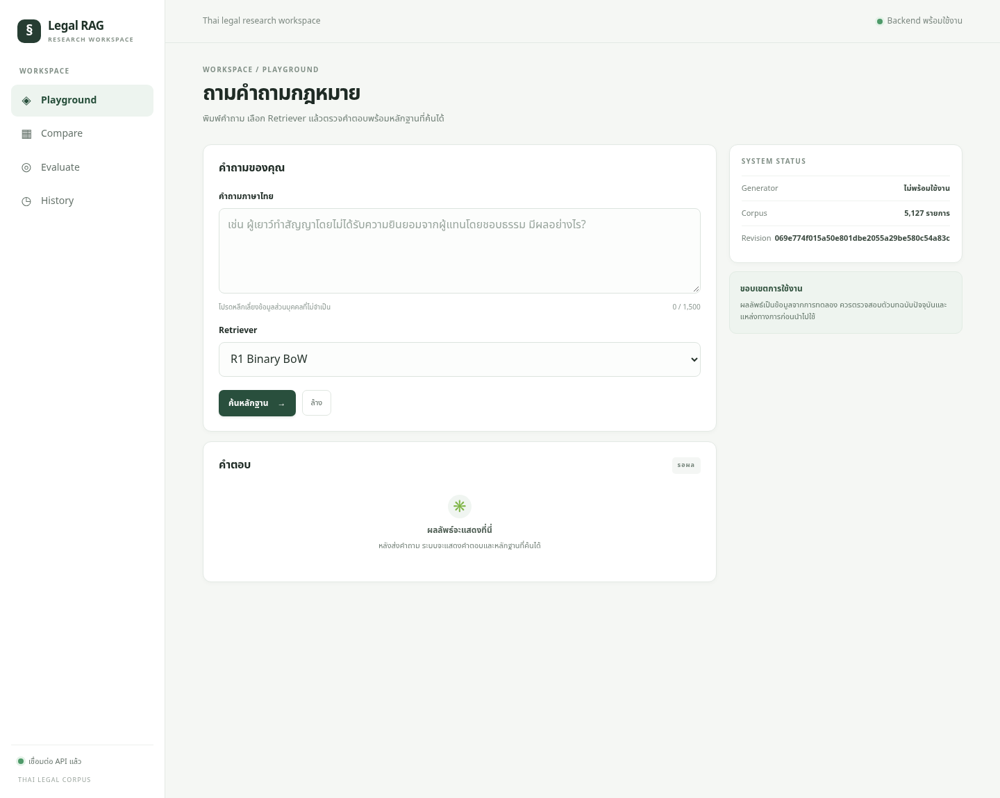
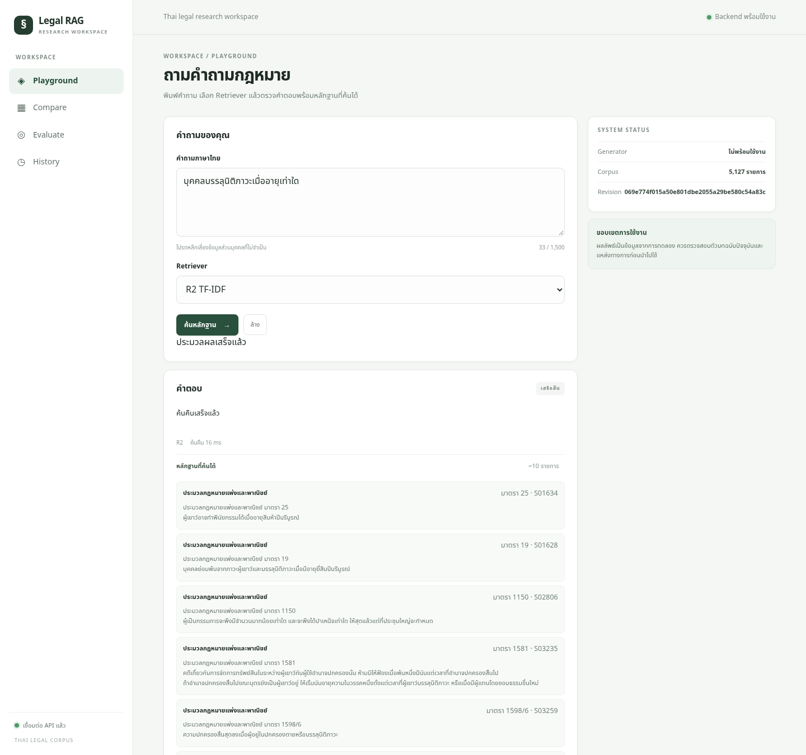
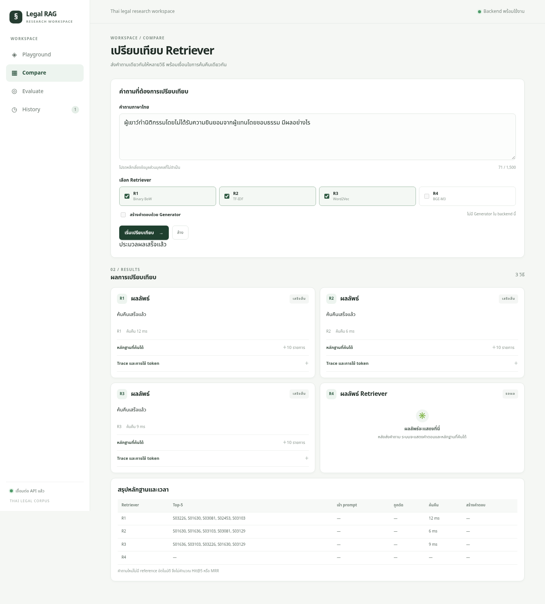
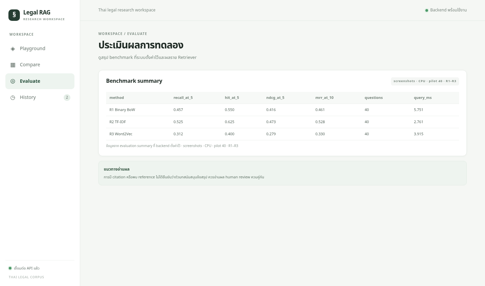
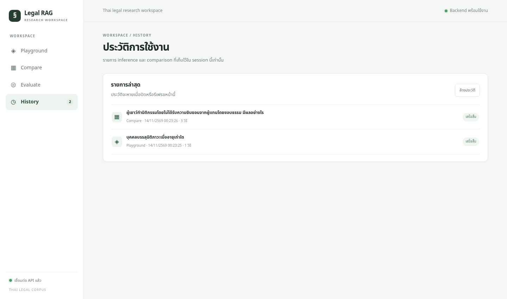
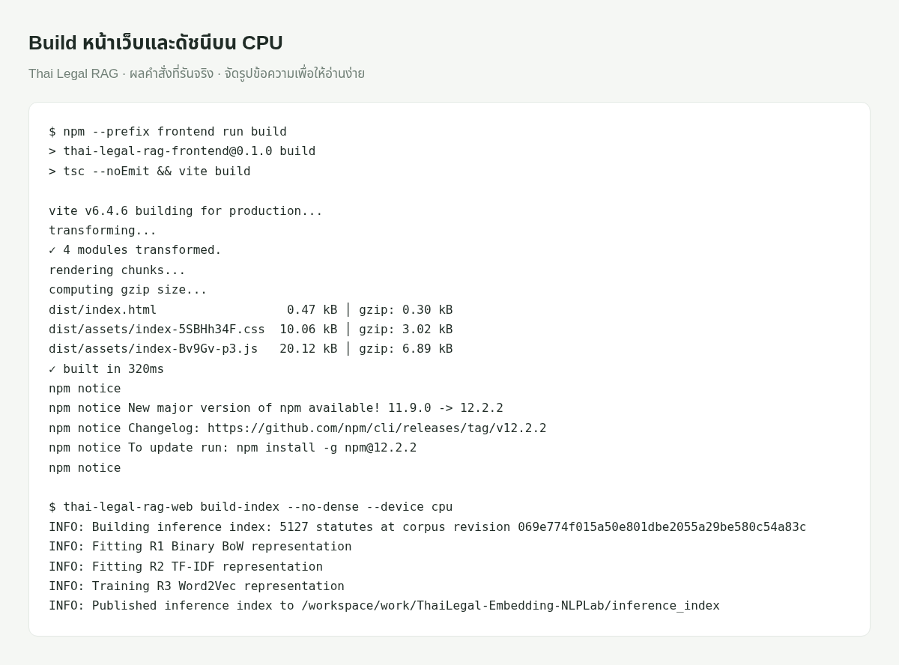
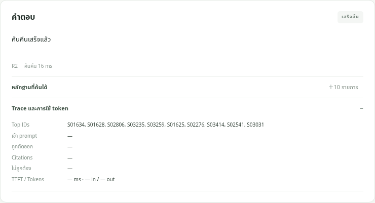
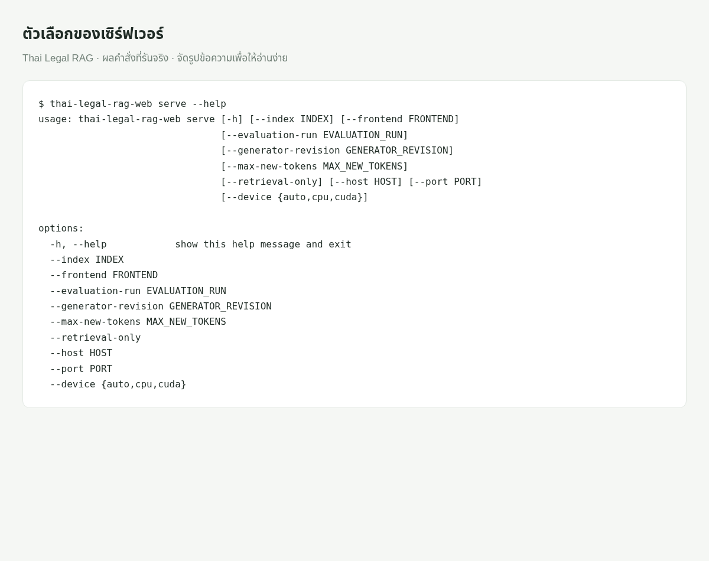
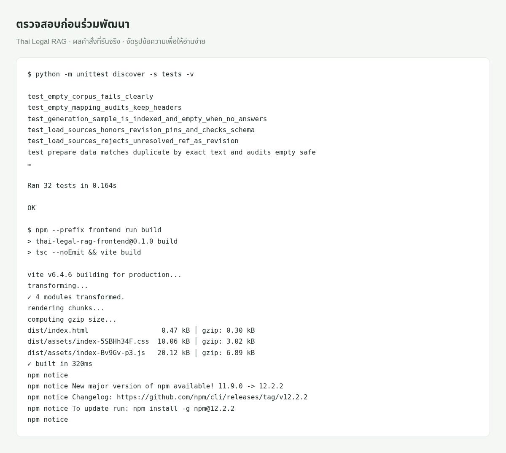
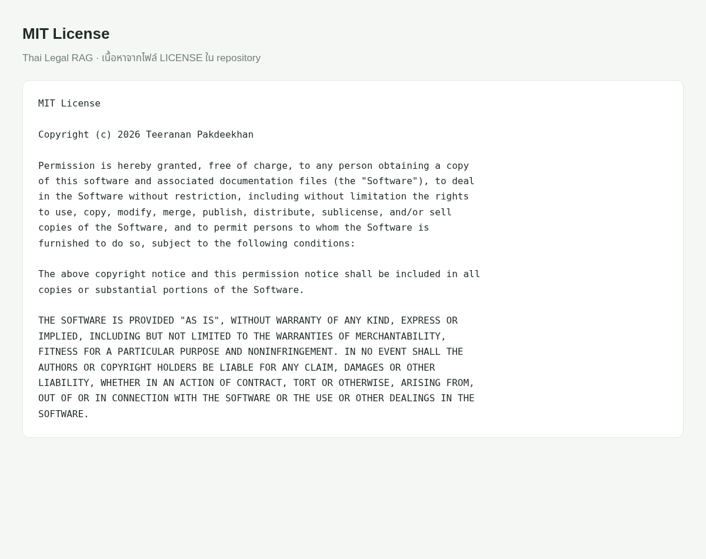

<div align="center">
  <h1>Thai Legal RAG</h1>
  <p>ค้นมาตรากฎหมายไทย เปรียบเทียบวิธีค้น 4 แบบ และดูว่าหลักฐานที่ค้นได้ส่งผลต่อคำตอบอย่างไร</p>
  <p>
    <a href="LICENSE"></a>
    <a href="pyproject.toml"></a>
  </p>
  <p>
    <a href="docs/README.md">คู่มือ</a> ·
    <a href="docs/getting-started.md#เปิดหน้าเว็บบนเครื่อง">เปิดเดโมบนเครื่อง</a> ·
    <a href="notebooks/Thai_Legal_RAG_Clean.ipynb">Notebook</a> ·
    <a href="https://github.com/01aptx01/ThaiLegal-Embedding-NLPLab/issues/new">แจ้งปัญหาหรือเสนอฟีเจอร์</a>
  </p>
</div>

## สารบัญ

- [เกี่ยวกับโปรเจกต์](#เกี่ยวกับโปรเจกต์)
- [สิ่งที่ทำได้](#สิ่งที่ทำได้)
- [เริ่มใช้งาน](#เริ่มใช้งาน)
- [วิธีใช้งาน](#วิธีใช้งาน)
- [การตั้งค่า](#การตั้งค่า)
- [ร่วมพัฒนา](#ร่วมพัฒนา)
- [สัญญาอนุญาตและแหล่งข้อมูล](#สัญญาอนุญาตและแหล่งข้อมูล)

## เกี่ยวกับโปรเจกต์

โปรเจกต์นี้ทดลองว่าเมื่อใช้คำถามและคลังกฎหมายชุดเดียวกัน วิธีค้นแบบไหนพามาตราที่เกี่ยวข้องขึ้นมาอยู่ในอันดับต้น ๆ เมื่อได้ผลค้นแล้ว ระบบจะส่งตัวบทให้ Typhoon สร้างคำตอบภาษาไทย โปรแกรมตรวจว่ารหัสที่คำตอบอ้างอยู่ในชุดตัวบทที่ส่งให้โมเดลหรือไม่ จากนั้นคนตรวจอ่านว่าตัวบทรองรับข้อความในคำตอบจริงหรือไม่

คลังที่ใช้คือชุด CCL จาก NitiBench หน่วยที่ค้นคือ **หนึ่งมาตราต่อหนึ่งรายการ** คำตอบบนหน้าเว็บใช้สำหรับทดลองกับคลังนี้ เมื่อนำข้อมูลไปอ้างอิง ให้ตรวจตัวบทฉบับปัจจุบันกับแหล่งทางการด้วย



ภาพในเอกสารนี้จับจากแอปที่รันจริงบน CPU ในโหมด `--retrieval-only` โดยสร้างดัชนีด้วย `--no-dense` จึงใช้ Binary BoW, TF-IDF และ Word2Vec ได้ ส่วน BGE-M3 และ Typhoon ยังไม่เปิดใช้งาน ดู [ที่มาของภาพและผลทดลอง](docs/screenshots/README.md)

## สิ่งที่ทำได้

### Playground

พิมพ์คำถาม เลือกวิธีค้น และเปิดอ่านตัวบท เมื่อเปิด Generator จะกดรหัสอ้างอิงในคำตอบเพื่อกลับไปดูหลักฐานได้ ภาพนี้ค้นคำถาม “บุคคลบรรลุนิติภาวะเมื่ออายุเท่าใด” ด้วย TF-IDF และเปิดรายการหลักฐานที่ API ส่งกลับจริง



### Compare

ส่งคำถามเดียวกันให้ Binary BoW, TF-IDF, Word2Vec หรือ BGE-M3 แล้วดูอันดับมาตราและเวลาที่ใช้แต่ละวิธี ภาพนี้เปรียบเทียบสามวิธีที่เปิดใช้งานบน CPU ส่วน R4 ยังไม่มีผลเพราะไม่ได้สร้างดัชนี BGE-M3



### Evaluate

เปิดตารางคะแนนจากรอบทดลองที่บันทึกไว้ ภาพนี้ใช้ผลที่คำนวณจริงจากคำถาม pilot 40 ข้อด้วย seed 42 สำหรับสามวิธีบน CPU เป็นรอบสำหรับประกอบภาพ ไม่ใช่ผล benchmark ครบสี่วิธี มี [ผลรายข้อและ manifest](docs/screenshots/evaluation/) ให้ตรวจสอบ



### History

เก็บรายการที่เพิ่งรันระหว่างเปิดหน้านั้น ภาพนี้แสดงคำถามจาก Playground และ Compare ที่รันก่อนจับภาพ ประวัติอยู่เฉพาะ session และหายเมื่อรีเฟรชหรือปิดหน้า



นอกจากหน้าเว็บ ยังมี **คำสั่งทดลอง** สำหรับรันบนชุดคำถามที่มีคำตอบและมาตราอ้างอิง บันทึกผลรายข้อ และส่งออกไฟล์ให้คนตรวจคำตอบโดยซ่อนชื่อวิธีค้น ดู [การทดลองและการประเมินผล](docs/evaluation.md)

## เริ่มใช้งาน

ใช้ Python 3.10 ขึ้นไป สำหรับหน้าเว็บให้เตรียม Node.js ด้วย ตัวอย่างนี้ใช้ Node.js 22 และรันบน CPU เพื่อทดลองค้นมาตราก่อน

```bash
python -m venv .venv
source .venv/bin/activate
python -m pip install -e ".[web]"
cd frontend
npm ci
npm run build
cd ..
thai-legal-rag-web build-index --no-dense --device cpu
thai-legal-rag-web serve --retrieval-only --device cpu
```

เปิด [http://127.0.0.1:8000](http://127.0.0.1:8000) ดัชนีที่สร้างแล้วใช้ซ้ำได้ ครั้งถัดไปเริ่มที่คำสั่ง `serve` ได้เลย สำหรับ PowerShell หรือการเปิด BGE-M3 และ Typhoon ดู [คู่มือเริ่มใช้งาน](docs/getting-started.md)



ภาพผลคำสั่งด้านบนจัดรูปจาก stdout จริง โดยเลือกบรรทัดสำคัญของการสร้างดัชนีเพื่อให้อ่านง่าย

## วิธีใช้งาน

| อยากทำอะไร | อ่านที่ไหน |
| --- | --- |
| ดูว่าข้อมูลมาจากไหนและโปรแกรมจับคู่เลขมาตราอย่างไร | [ข้อมูลและการจับคู่มาตรา](docs/data.md) |
| เข้าใจวิธีค้นทั้งสี่แบบและเหตุผลที่อันดับต่างกัน | [การค้นมาตรา](docs/retrieval.md) |
| ตามว่าตัวบทไหนถูกส่งให้โมเดลและคำตอบอ้างอะไร | [การสร้างคำตอบ](docs/generation.md) |
| รัน pilot หรือ test แล้วอ่านคะแนนและนำเข้าคะแนนคนตรวจ | [การทดลองและการประเมินผล](docs/evaluation.md) |
| เปิดเว็บ เชื่อม API หรือตามโค้ดจากหน้าจอไปถึงโมเดล | [หน้าเว็บและ API](docs/inference-web.md) |

ดูแผนที่ไฟล์และตารางเทียบเซลล์ของ Notebook ได้ที่ [สารบัญเอกสาร](docs/README.md)



เปิด “Trace และการใช้ token” ใต้ผลลัพธ์เพื่อตามรหัสมาตรา ภาพนี้ใช้โหมดค้นอย่างเดียว จึงมี Top IDs ส่วน prompt, citation และ token ยังไม่มีค่า

## การตั้งค่า

| ค่าที่ใช้บ่อย | อยู่ที่ไหน |
| --- | --- |
| เลือก CPU หรือ GPU | `--device cpu` หรือ `--device cuda` |
| จำนวนคำถามและ seed ของการทดลอง | `thai-legal-rag run --help` |
| โฟลเดอร์ดัชนีและผลทดลองที่จะแสดงบนหน้าเว็บ | `thai-legal-rag-web serve --help` |
| รุ่นข้อมูลและโมเดลที่ใช้จริง | `manifest.json` ในโฟลเดอร์ผลรันหรือโฟลเดอร์ดัชนี |



ภาพนี้จัดรูปจากผลคำสั่ง `thai-legal-rag-web serve --help` ที่รันจริง

## ร่วมพัฒนา

เมื่อต้องแก้วิธีค้นหรือเกณฑ์วัดผล ให้อธิบายใน Pull Request ว่ากระทบไฟล์ผลรันและการเทียบกับผลเดิมอย่างไร ถ้าแจ้งปัญหาการรัน ให้แนบคำสั่ง ข้อความผิดพลาด และรุ่นข้อมูลหรือโมเดลจาก `manifest.json` หากมี

```bash
python -m unittest discover -s tests -v
npm --prefix frontend run build
```



ภาพนี้แสดงบางรายชื่อการทดสอบ พร้อมสรุปผลจริงทั้ง 32 ข้อและผล build หน้าเว็บ

## สัญญาอนุญาตและแหล่งข้อมูล

โค้ดใช้ [MIT License](LICENSE) ส่วนชุดข้อมูลและโมเดลอยู่ภายใต้เงื่อนไขของผู้เผยแพร่แต่ละราย ดู [ชุดข้อมูลที่ใช้](docs/data.md#ชุดข้อมูลที่ใช้) และ [โมเดลที่ใช้](docs/retrieval.md#วิธีค้นทั้งสี่แบบ)


